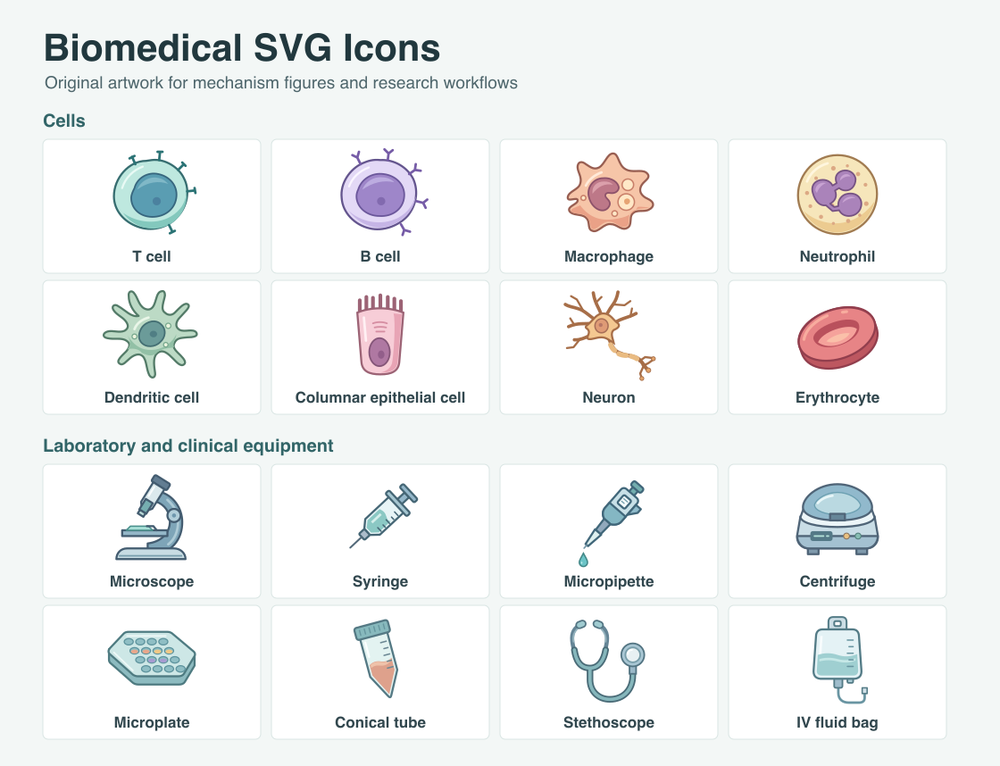
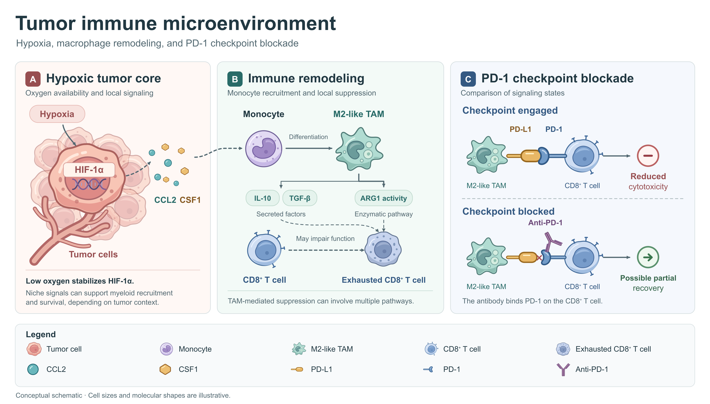

# Editable Biomedical Mechanism Figures

[English](./README.md) | [中文](./README.zh-CN.md)

**Create BioRender-inspired mechanism figures as editable SVGs.** Recolor a cell, redraw a receptor, or swap a single icon in the finished figure. Cells, arrows, and labels are separate objects you can move or delete.

This Agent Skill turns manuscript paragraphs, pathway descriptions, and review topics into mechanism figures, graphical abstracts, or experimental workflows. Each figure comes with its reusable icon files.

[Try the editable example](#editable-mechanism-figure) · [Edit or replace an icon](#edit-or-replace-an-icon)

> Not affiliated with BioRender. This skill aims for an original, BioRender-inspired scientific visual language and explicitly avoids copying BioRender assets, templates, logos, or proprietary icons.

## Editable SVG Icons

The skill includes 16 general-purpose cell and equipment icons and 14 tumor immunology icons. Each icon has a transparent background and separate vector groups for individual parts.

[](./gallery/icons.md)

[Browse and open the individual SVG files](./gallery/icons.md).

## Editable Mechanism Figure

Tumor immune microenvironment assembled from individual SVG icons. The cells, molecules, arrows, labels, and legend entries can be edited separately.

[](./gallery/tumor-immune-microenvironment/figure.svg)

[Editable figure and icon sources](./gallery/examples/tumor-immune-microenvironment.md#editable-figure)

## Edit or Replace an Icon

Ask the skill to change a shape, outline, color, or level of detail, or provide an SVG of your own. Name the panel or position for a single replacement, or ask to replace every instance of that icon. For manual edits, open `figure.svg` in Inkscape or Illustrator and enter the icon's group to select a part.

```text
Use $biorender-mechanism-figures to redraw only the macrophage in panel B with a rounder outline and a muted green fill. Save the new icon separately and apply it to that instance.
```

For figures created by the skill, keep `figure.svg`, `layout.svg`, and `icons/` together for later revisions. If you have already edited the figure by hand, provide the latest SVG as the starting point. The skill returns the revised icon and a revised figure when you ask it to apply the change.

## Repository Name

Recommended GitHub repository name:

```text
biorender-mechanism-figures-skill
```

## How Figure Creation Works

1. Identify the required cells, molecules, compartments, and relationships.
2. Reuse suitable icons and draw missing ones as standalone SVGs.
3. Assemble `figure.svg` with separately editable icons, arrows, and text. Deliver it with `layout.svg` and the used `icons/` files.

Installing the complete `biorender-mechanism-figures/` folder includes the icon library and assembly helper. The helper uses Python 3.9+ and runs locally without an image-generation account. For a prompt or raster draft, ask for that output explicitly.

## Publication-Quality Output

For an editable journal figure, assemble an SVG with separate icons, connectors, and text. Keep the SVG source and export vector PDF when the journal requests it. For a raster draft, use the largest suitable native image size and verify its effective PPI at final print dimensions against the journal's artwork requirements. Apply final labels in a separate editable layer when needed.

## Repository Structure

```text
.
├── biorender-mechanism-figures/
│   ├── SKILL.md
│   ├── assets/icons/
│   ├── agents/openai.yaml
│   ├── references/
│   └── scripts/                 # SVG assembler and prompt builder
├── gallery/
│   ├── README.md
│   └── examples/
└── README.md
```

## Use In Codex

Install as a personal Codex skill:

```bash
rsync -a ./biorender-mechanism-figures/ ~/.codex/skills/biorender-mechanism-figures/
```

Restart Codex, then invoke:

```text
Use $biorender-mechanism-figures to draw a two-panel schematic of intestinal mucus secretion. Deliver the editable SVG figure and the individual icon SVGs.
```

## Use In Claude Code

The core skill uses the standard `SKILL.md` folder pattern, so it can also be used in Claude Code.

Personal install:

```bash
rsync -a ./biorender-mechanism-figures/ ~/.claude/skills/biorender-mechanism-figures/
```

Project install:

```bash
mkdir -p .claude/skills
rsync -a ./biorender-mechanism-figures/ .claude/skills/biorender-mechanism-figures/
```

Restart Claude Code after installing or updating.

## Use In OpenCode

OpenCode supports Agent Skills defined by `SKILL.md`.

Global install:

```bash
mkdir -p ~/.config/opencode/skills
rsync -a ./biorender-mechanism-figures/ ~/.config/opencode/skills/biorender-mechanism-figures/
```

Project install:

```bash
mkdir -p .opencode/skills
rsync -a ./biorender-mechanism-figures/ .opencode/skills/biorender-mechanism-figures/
```

OpenCode can also read Claude-compatible skill locations such as `.claude/skills/` and `~/.claude/skills/`, so one shared install may be enough if you use both Claude Code and OpenCode.

## Example

This example creates a tumor immune microenvironment mechanism figure for an oncology review.

```text
Use $biorender-mechanism-figures to create a landscape 16:9 oncology review mechanism figure: hypoxia-driven tumor-associated macrophage polarization and T cell exhaustion. Show three left-to-right zones: hypoxic tumor core, immune remodeling, immunotherapy response.

Include tumor cells, HIF-1alpha, CCL2/CSF1, recruited monocytes, M2 TAMs, exhausted CD8+ T cells, PD-1/PD-L1, and anti-PD-1 therapy.

Style: original BioRender-inspired biomedical schematic, ultra-high-resolution, print-ready, clean white background, crisp vector-like cells, sharp edges, muted teal/coral/blue/gold/gray palette, clear arrows, large readable labels, generous whitespace, SVG/PDF-ready composition, no copied icons, no watermark.
```

More examples are available in the [gallery](./gallery/README.md).

## Prompt Builder

You can also generate a reusable prompt from the command line:

```bash
python biorender-mechanism-figures/scripts/build_prompt.py \
  --topic "Tumor-associated macrophage polarization in the hypoxic tumor microenvironment" \
  --figure-type mechanism \
  --audience "review article" \
  --canvas "landscape 16:9" \
  --output-target "PNG draft with sharp edges and space for vector labels" \
  --elements "tumor cell,hypoxia,HIF-1alpha,M2 macrophage,T cell exhaustion,anti-PD-1 therapy" \
  --flow "Hypoxia stabilizes HIF-1alpha; tumor cells secrete CCL2 and CSF1; monocytes enter tumor; macrophages polarize toward M2; exhausted T cells reduce killing; anti-PD-1 partially restores cytotoxicity" \
  --labels "Hypoxia,HIF-1alpha,CCL2/CSF1,M2 TAM,Exhausted T cell,anti-PD-1"
```

## Portability Notes

- The core skill is portable because it is plain Markdown plus a `SKILL.md` frontmatter block.
- `scripts/build_prompt.py` is portable anywhere Python 3 is available.
- `agents/openai.yaml` is Codex-specific UI metadata; other platforms can ignore it.
- Raster generation depends on the platform's image tools. The bundled SVGs open directly in vector editors.
