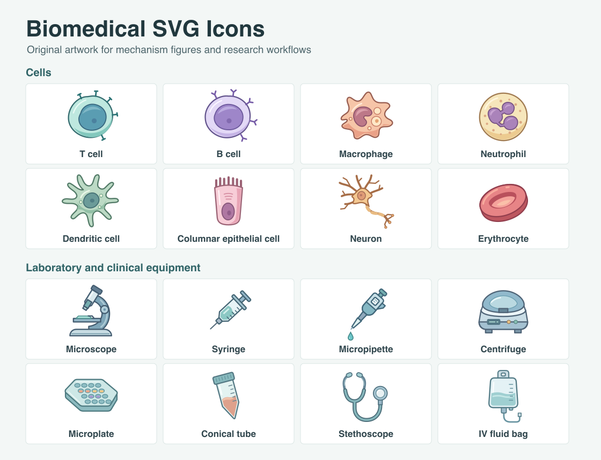
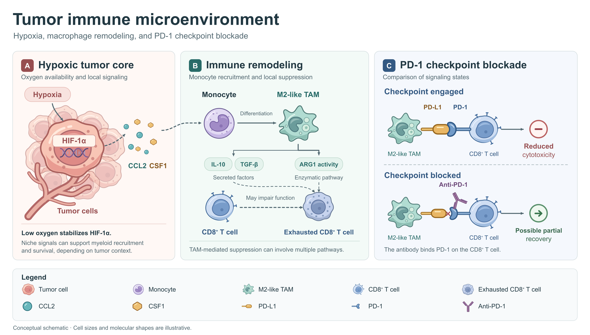

# 可编辑的生物医学机制图

[English](./README.md) | [中文](./README.zh-CN.md)

**生成可编辑的 BioRender 风格 SVG 机制图。** 细胞、箭头和文字都可以单独移动或删除。图标的颜色、轮廓和细节可以修改，也可以只替换图中的某一个实例。

这个 Agent Skill 可以把论文段落、通路描述或综述主题画成机制图、图形摘要或实验流程图，同时交付可复用的独立图标。

[试用可编辑示例](#可编辑机制图) · [修改或替换图标](#修改或替换图标)

> 本项目与 BioRender 无从属关系。这个 skill 追求原创的 BioRender-inspired 科学视觉语言，并明确避免复制 BioRender 资产、模板、logo 或专有图标。

## 可编辑 SVG 图标

Skill 内置 16 枚通用细胞和器材图标，以及 14 枚肿瘤免疫图标。每枚图标均为透明背景，内部部件按矢量对象分组，可以单独编辑。

[](./gallery/icons.md)

[浏览图标目录并打开独立 SVG 文件](./gallery/icons.md)。

## 可编辑机制图

肿瘤免疫微环境图由独立 SVG 图标组装而成。细胞、分子、箭头、标签和图例条目都可以单独编辑。

[](./gallery/tumor-immune-microenvironment/figure.svg)

[查看可编辑成图和独立图标](./gallery/examples/tumor-immune-microenvironment.md#editable-figure)

## 修改或替换图标

可以直接让 skill 修改图标的形状、描边、配色或细节，也可以提供自己的 SVG。按面板或位置指定修改某一个实例，或要求统一替换全图中的同类图标。手动编辑时，用 Inkscape 或 Illustrator 打开 `figure.svg`，进入图标的分组即可选中单个部件。

```text
用 $biorender-mechanism-figures，只把 B 面板的巨噬细胞画得更圆，改成低饱和绿色。把新图标单独保存，并替换图中的这一个实例。
```

建议一并保留 `figure.svg`、`layout.svg` 和 `icons/`。已经手动改过图时，把最新的 SVG 交给 skill 继续编辑。要求把修改应用到成图时，skill 会同时交付修改后的图标和新版成图。

## 仓库名

推荐 GitHub 仓库名：

```text
biorender-mechanism-figures-skill
```

## 做图流程

1. 盘点细胞、分子、区室和机制关系。
2. 复用合适的图标，把缺少的元素单独画成 SVG。
3. 组装 `figure.svg`，让图标、箭头和文字都能单独编辑，同时交付 `layout.svg` 和使用到的 `icons/` 文件。

完整安装 `biorender-mechanism-figures/` 目录即可获得图标库和组装脚本。脚本使用 Python 3.9+，可在本地运行，无需图像生成账号。需要提示词或栅格草图时，可在请求里指定。

## 出版级输出

需要可编辑的期刊图时，使用 SVG 组装图标、连接线和文字，保留 SVG 源文件，并按期刊要求导出矢量 PDF。生成栅格草图时，选择工具支持的合适原生尺寸上限，并按最终印刷尺寸核对有效 PPI 是否满足期刊要求。需要时，在独立的可编辑图层中加入最终标签。

## 仓库结构

```text
.
├── biorender-mechanism-figures/
│   ├── SKILL.md
│   ├── assets/icons/
│   ├── agents/openai.yaml
│   ├── references/
│   └── scripts/                 # SVG 组装脚本与提示词生成脚本
├── gallery/
│   ├── README.md
│   └── examples/
└── README.md
```

## 在 Codex 中使用

安装为个人 Codex skill：

```bash
rsync -a ./biorender-mechanism-figures/ ~/.codex/skills/biorender-mechanism-figures/
```

重启 Codex，然后直接提出做图需求。

```text
用 $biorender-mechanism-figures 画一张双面板肠道黏液分泌示意图，交付可编辑的 SVG 成图和独立图标。
```

## 在 Claude Code 中使用

这个 skill 使用标准 `SKILL.md` 文件夹模式，因此也可以用于 Claude Code。

个人安装：

```bash
rsync -a ./biorender-mechanism-figures/ ~/.claude/skills/biorender-mechanism-figures/
```

项目安装：

```bash
mkdir -p .claude/skills
rsync -a ./biorender-mechanism-figures/ .claude/skills/biorender-mechanism-figures/
```

安装或更新后，请重启 Claude Code。

## 在 OpenCode 中使用

OpenCode 支持由 `SKILL.md` 定义的 Agent Skills。

全局安装：

```bash
mkdir -p ~/.config/opencode/skills
rsync -a ./biorender-mechanism-figures/ ~/.config/opencode/skills/biorender-mechanism-figures/
```

项目安装：

```bash
mkdir -p .opencode/skills
rsync -a ./biorender-mechanism-figures/ .opencode/skills/biorender-mechanism-figures/
```

OpenCode 也可以读取 Claude 兼容的 skill 位置，例如 `.claude/skills/` 和 `~/.claude/skills/`。如果你同时使用 Claude Code 和 OpenCode，一份共享安装通常就足够。

## 示例

这个示例用于为肿瘤免疫综述创建一个肿瘤微环境机制图。

```text
Use $biorender-mechanism-figures to create a landscape 16:9 oncology review mechanism figure: hypoxia-driven tumor-associated macrophage polarization and T cell exhaustion. Show three left-to-right zones: hypoxic tumor core, immune remodeling, immunotherapy response.

Include tumor cells, HIF-1alpha, CCL2/CSF1, recruited monocytes, M2 TAMs, exhausted CD8+ T cells, PD-1/PD-L1, and anti-PD-1 therapy.

Style: original BioRender-inspired biomedical schematic, ultra-high-resolution, print-ready, clean white background, crisp vector-like cells, sharp edges, muted teal/coral/blue/gold/gray palette, clear arrows, large readable labels, generous whitespace, SVG/PDF-ready composition, no copied icons, no watermark.
```

更多示例见 [gallery](./gallery/README.md)。

## Prompt Builder

也可以直接用命令行生成可复用 prompt：

```bash
python biorender-mechanism-figures/scripts/build_prompt.py \
  --topic "Tumor-associated macrophage polarization in the hypoxic tumor microenvironment" \
  --figure-type mechanism \
  --audience "review article" \
  --canvas "landscape 16:9" \
  --output-target "PNG draft with sharp edges and space for vector labels" \
  --elements "tumor cell,hypoxia,HIF-1alpha,M2 macrophage,T cell exhaustion,anti-PD-1 therapy" \
  --flow "Hypoxia stabilizes HIF-1alpha; tumor cells secrete CCL2 and CSF1; monocytes enter tumor; macrophages polarize toward M2; exhausted T cells reduce killing; anti-PD-1 partially restores cytotoxicity" \
  --labels "Hypoxia,HIF-1alpha,CCL2/CSF1,M2 TAM,Exhausted T cell,anti-PD-1"
```

## 跨平台说明

- 核心 skill 是纯 Markdown 加 `SKILL.md` frontmatter，因此具备跨平台可移植性。
- `scripts/build_prompt.py` 只需要 Python 3。
- `agents/openai.yaml` 是 Codex 专用 UI 元数据，其他平台可以忽略。
- 栅格图像生成能力取决于具体平台。内置 SVG 文件可以直接在矢量编辑器中打开。
