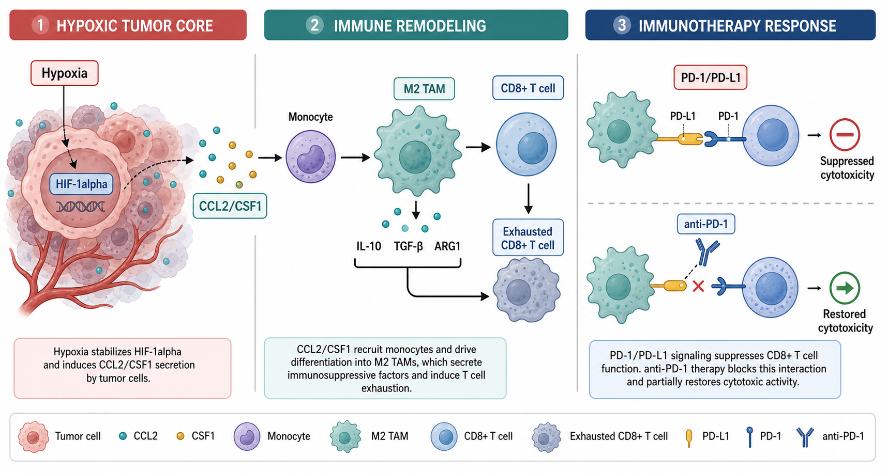

# BioRender 机制图 Skill

[English](./README.md) | [中文](./README.zh-CN.md)

这是一个 Agent Skill，用于为 GPT Image 模型和其他图像生成流程创建 BioRender-inspired、出版级清晰度的生物医学机制图 prompt。

它可以帮助智能体把论文段落、科学假设、通路描述、综述主题或基金想法转换成清晰的科学示意图：机制图、图形摘要、综述示意图、通路图和实验流程图。

> 本项目与 BioRender 无从属关系。这个 skill 追求原创的 BioRender-inspired 科学视觉语言，并明确避免复制 BioRender 资产、模板、logo 或专有图标。

## 效果预览

下面的示例图由 gallery 中的肿瘤免疫微环境 prompt 生成：



## 仓库名

推荐 GitHub 仓库名：

```text
biorender-mechanism-figures-skill
```

## 它能做什么

- 把生物医学内容转换成结构化图像生成 prompt
- 强制使用机制优先的构图方式：科学故事、区室、参与者、箭头、标签
- 默认生成高分辨率、print-ready 的 prompt 描述
- 鼓励 SVG/PDF-ready 的布局，适合期刊、海报和幻灯片工作流
- 包含肿瘤学、神经科学、微生物组、药理学、单细胞方法和免疫学示例
- 可作为 Codex skill 使用，也可迁移到 Claude Code 或 OpenCode

## 出版级输出

这个 skill 默认追求出版级清晰度：

- 超高分辨率、print-ready 的示意图 prompt
- 清晰的矢量感边缘和统一线宽
- 更大的可读标签和充足留白
- 当图像工具支持时，优先使用 SVG/PDF-ready 构图
- 如果只能输出 PNG，则使用最高分辨率，并按 300-600 DPI 印刷流程处理

对于期刊图，推荐先生成无标签或轻标签版本，再在 Illustrator、Inkscape、PowerPoint、Affinity Designer 或 BioRender 中添加最终文字。这样可以避免 AI 生成小字不清晰的问题，也方便后续修改。

## 仓库结构

```text
.
├── biorender-mechanism-figures/
│   ├── SKILL.md
│   ├── agents/openai.yaml
│   ├── references/visual-language.md
│   └── scripts/build_prompt.py
├── gallery/
│   ├── README.md
│   └── examples/
└── README.md
```

## 在 Codex 中使用

安装为个人 Codex skill：

```bash
rsync -a ./biorender-mechanism-figures/ ~/.codex/skills/biorender-mechanism-figures/
```

重启 Codex，然后这样调用：

```text
Use $biorender-mechanism-figures to create a publication-ready mechanism figure prompt for ...
```

中文也可以：

```text
用 $biorender-mechanism-figures 帮我把这个机制做成出版级清晰度的综述机制图 prompt。
```

## 在 Claude Code 中使用

这个 skill 使用标准 `SKILL.md` 文件夹模式，因此也可以用于 Claude Code。

个人安装：

```bash
rsync -a ./biorender-mechanism-figures/ ~/.claude/skills/biorender-mechanism-figures/
```

项目安装：

```bash
mkdir -p .claude/skills
rsync -a ./biorender-mechanism-figures/ .claude/skills/biorender-mechanism-figures/
```

安装或更新后，请重启 Claude Code。

## 在 OpenCode 中使用

OpenCode 支持由 `SKILL.md` 定义的 Agent Skills。

全局安装：

```bash
mkdir -p ~/.config/opencode/skills
rsync -a ./biorender-mechanism-figures/ ~/.config/opencode/skills/biorender-mechanism-figures/
```

项目安装：

```bash
mkdir -p .opencode/skills
rsync -a ./biorender-mechanism-figures/ .opencode/skills/biorender-mechanism-figures/
```

OpenCode 也可以读取 Claude 兼容的 skill 位置，例如 `.claude/skills/` 和 `~/.claude/skills/`。如果你同时使用 Claude Code 和 OpenCode，一份共享安装通常就足够。

## 示例

这个示例用于为肿瘤免疫综述创建一个肿瘤微环境机制图。

```text
Use $biorender-mechanism-figures to create a landscape 16:9 oncology review mechanism figure: hypoxia-driven tumor-associated macrophage polarization and T cell exhaustion. Show three left-to-right zones: hypoxic tumor core, immune remodeling, immunotherapy response.

Include tumor cells, HIF-1alpha, CCL2/CSF1, recruited monocytes, M2 TAMs, exhausted CD8+ T cells, PD-1/PD-L1, and anti-PD-1 therapy.

Style: original BioRender-inspired biomedical schematic, ultra-high-resolution, print-ready, clean white background, crisp vector-like cells, sharp edges, muted teal/coral/blue/gold/gray palette, clear arrows, large readable labels, generous whitespace, SVG/PDF-ready composition, no copied icons, no watermark.
```

更多示例见 [gallery](./gallery/README.md)。

## Prompt Builder

也可以直接用命令行生成可复用 prompt：

```bash
python biorender-mechanism-figures/scripts/build_prompt.py \
  --topic "Tumor-associated macrophage polarization in the hypoxic tumor microenvironment" \
  --figure-type mechanism \
  --audience "review article" \
  --canvas "landscape 16:9" \
  --output-target "SVG/PDF-ready publication figure, or 4K+ PNG suitable for 300-600 DPI print" \
  --elements "tumor cell,hypoxia,HIF-1alpha,M2 macrophage,T cell exhaustion,anti-PD-1 therapy" \
  --flow "Hypoxia stabilizes HIF-1alpha; tumor cells secrete CCL2 and CSF1; monocytes enter tumor; macrophages polarize toward M2; exhausted T cells reduce killing; anti-PD-1 partially restores cytotoxicity" \
  --labels "Hypoxia,HIF-1alpha,CCL2/CSF1,M2 TAM,Exhausted T cell,anti-PD-1"
```

## 跨平台说明

- 核心 skill 是纯 Markdown 加 `SKILL.md` frontmatter，因此具备跨平台可移植性。
- `scripts/build_prompt.py` 只需要 Python 3。
- `agents/openai.yaml` 是 Codex 专用 UI 元数据，其他平台可以忽略。
- 图像生成能力取决于具体平台。如果不能直接导出 SVG/PDF，就生成最高分辨率栅格图，再在矢量编辑器中转换或重建最终图。
