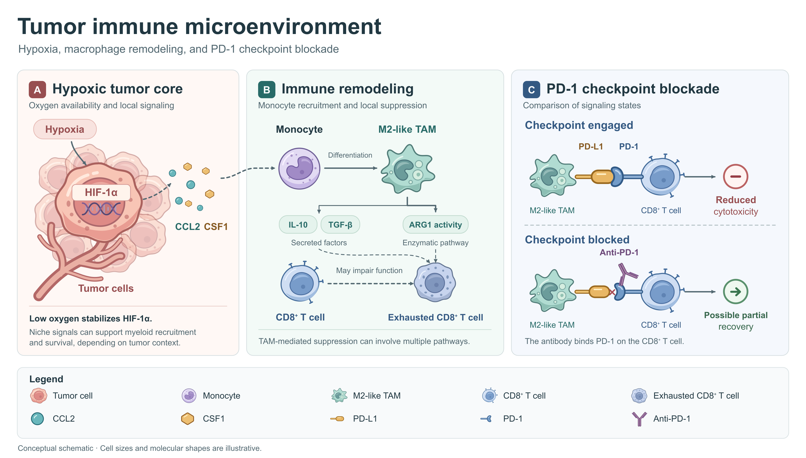

# Tumor Immune Microenvironment

## Editable Figure

[](../tumor-immune-microenvironment/figure.svg)

[Open the editable SVG](../tumor-immune-microenvironment/figure.svg) · [View the original reference preview](../../assets/tumor-immune-microenvironment-preview.png)

Open the SVG in Illustrator or Inkscape. The three panels and legend are organized into named layers. Select an icon, connector, or label to move or remove it. Enter an icon group to edit parts such as the nucleus, membrane, or receptor ectodomain. Each repeated icon is a separate editable instance.

### Standalone Icons

| Category | Individual SVG files |
| --- | --- |
| Cells | [Tumor cell](../../biorender-mechanism-figures/assets/icons/tumor-immune/tumor-cell.svg), [monocyte](../../biorender-mechanism-figures/assets/icons/tumor-immune/monocyte.svg), [M2-like TAM](../../biorender-mechanism-figures/assets/icons/tumor-immune/m2-like-tam.svg), [CD8⁺ T cell](../../biorender-mechanism-figures/assets/icons/tumor-immune/cd8-t-cell.svg), [exhausted CD8⁺ T cell](../../biorender-mechanism-figures/assets/icons/tumor-immune/exhausted-t-cell.svg) |
| Tissue and nucleus | [Branching blood vessel](../../biorender-mechanism-figures/assets/icons/tumor-immune/blood-vessel.svg), [DNA](../../biorender-mechanism-figures/assets/icons/tumor-immune/dna.svg) |
| Recruitment signals | [CCL2](../../biorender-mechanism-figures/assets/icons/tumor-immune/ccl2.svg), [CSF1](../../biorender-mechanism-figures/assets/icons/tumor-immune/csf1.svg) |
| Checkpoint | [PD-L1](../../biorender-mechanism-figures/assets/icons/tumor-immune/pd-l1.svg), [PD-1](../../biorender-mechanism-figures/assets/icons/tumor-immune/pd-1.svg), [anti-PD-1 antibody](../../biorender-mechanism-figures/assets/icons/tumor-immune/anti-pd-1.svg) |
| Outcomes | [Reduced cytotoxicity](../../biorender-mechanism-figures/assets/icons/tumor-immune/cytotoxicity-suppressed.svg), [possible partial recovery](../../biorender-mechanism-figures/assets/icons/tumor-immune/cytotoxicity-partial-recovery.svg) |

HIF-1α, IL-10, TGF-β, ARG1, and the pathway annotations are editable text. The cells and molecular glyphs use schematic shapes and sizes. Rebuild the SVG from the icon files with `python3 gallery/tumor-immune-microenvironment/build_figure.py`; keep manual edits in a separate copy before regenerating.

### Scientific Context

The diagram combines findings from different experimental systems. In panel A, low oxygen stabilizes HIF-1α, while the recruitment branch represents context-dependent signals in the tumor niche. [Jaakkola et al., Science](https://pubmed.ncbi.nlm.nih.gov/11292861/) · [Qian et al., Nature](https://pmc.ncbi.nlm.nih.gov/articles/3208506/) · [Tumor–macrophage signaling study](https://pmc.ncbi.nlm.nih.gov/articles/PMC2725301/)

Panel B draws ARG1 as enzymatic activity alongside secreted factors. Panel C shows antibody binding to PD-1 and a potential partial recovery of T-cell function. [Macrophage IL-10 study](https://pmc.ncbi.nlm.nih.gov/articles/PMC4254570/) · [ARG1 study](https://pubmed.ncbi.nlm.nih.gov/36727849/) · [Host-cell PD-L1 study](https://www.jci.org/articles/view/96061) · [Anti-PD-1 imaging study](https://pmc.ncbi.nlm.nih.gov/articles/PMC5734617/)

## Use Case

Mechanism figure for a review article explaining how hypoxia shapes macrophage polarization and T cell exhaustion in the tumor microenvironment.

## Layout Plan

- Canvas: landscape 16:9
- Reading direction: left to right
- Zones: hypoxic tumor core, immune infiltration region, therapy response region
- Main visual hierarchy: tumor cell and macrophage interactions first, T cell exhaustion second, anti-PD-1 rescue third

## Ready-to-Use Prompt

```text
Create a publication-ready biomedical schematic, BioRender-inspired but fully original.

Topic: Hypoxia-driven tumor-associated macrophage polarization and T cell exhaustion in the tumor microenvironment.
Figure type: mechanism figure.
Audience/context: oncology review article.
Canvas: landscape 16:9, clean white background.

Layout:
One left-to-right mechanism with three visual zones: hypoxic tumor core on the left, immune remodeling in the center, immunotherapy response on the right. Use clear compartment spacing and a dominant causal arrow path.

Main visual elements:
- tumor cells in a hypoxic tumor niche
- HIF-1alpha activation
- CCL2 and CSF1 secretion
- recruited monocyte
- M2-like tumor-associated macrophage
- exhausted CD8+ T cell
- PD-1/PD-L1 interaction
- anti-PD-1 antibody therapy

Mechanism flow:
1. Hypoxia stabilizes HIF-1alpha in tumor cells.
2. Tumor cells secrete CCL2 and CSF1 to recruit monocytes.
3. Monocytes differentiate into M2-like tumor-associated macrophages.
4. M2-like macrophages support immunosuppression and T cell exhaustion.
5. PD-1/PD-L1 signaling reduces CD8+ T cell killing.
6. Anti-PD-1 therapy partially restores cytotoxic activity.

Labels to include exactly:
Hypoxia, HIF-1alpha, CCL2/CSF1, M2 TAM, CD8+ T cell, PD-1/PD-L1, anti-PD-1.

Visual style:
Crisp vector-like biomedical illustration, soft cellular shapes, muted teal, coral, blue, gold, and gray palette, subtle shadows, consistent line weight, clear activation arrows, blunt inhibition marks, short legible labels, journal-review polish.

Avoid:
photorealistic rendering, copied commercial icons, logos, watermark, tiny fake labels, excessive text, crowded arrows, dark background, decorative gradients.
```

## Iteration Prompts

```text
Regenerate with wider spacing between the macrophage and T cell interaction, fewer cytokine particles, and larger labels.
```

```text
Create an unlabeled version with the same layout so labels can be added later in Illustrator or PowerPoint.
```

