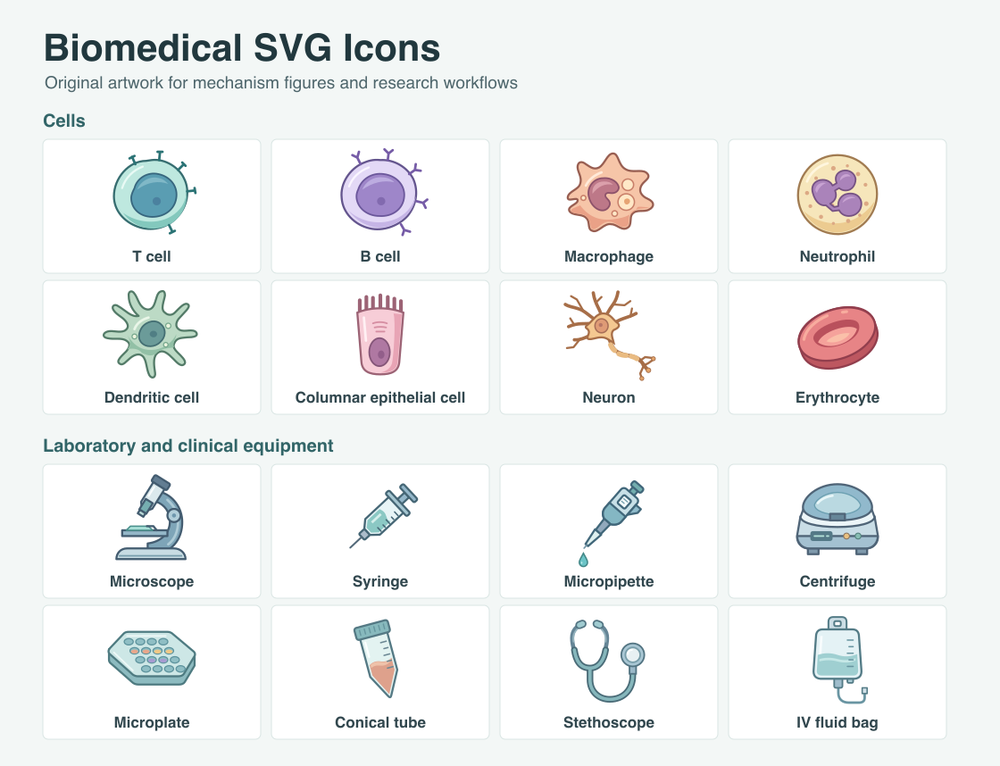

# Biomedical SVG Icons / 生物医学 SVG 图标

Each link opens a standalone SVG with a transparent background. Open the SVG in Inkscape or Illustrator and ungroup it to select, recolor, move, or remove individual parts. Keep the SVG for edits and export a vector PDF for submission when required.

每个链接对应一个独立、透明背景的 SVG。用 Inkscape 或 Illustrator 打开并取消编组，即可选择、改色、移动或删除单独部件。保留 SVG 源文件，需要投稿时可从矢量编辑器导出 PDF。

See also the [14 tumor immunology icons / 14 枚肿瘤免疫图标](./examples/tumor-immune-microenvironment.md#standalone-icons) bundled with the skill.

## Cells / 细胞

| SVG | 中文 |
| --- | --- |
| [T cell](../biorender-mechanism-figures/assets/icons/cells/t-cell.svg) | T 细胞 |
| [B cell](../biorender-mechanism-figures/assets/icons/cells/b-cell.svg) | B 细胞 |
| [Macrophage](../biorender-mechanism-figures/assets/icons/cells/macrophage.svg) | 巨噬细胞 |
| [Neutrophil](../biorender-mechanism-figures/assets/icons/cells/neutrophil.svg) | 中性粒细胞 |
| [Dendritic cell](../biorender-mechanism-figures/assets/icons/cells/dendritic-cell.svg) | 树突状细胞 |
| [Columnar epithelial cell](../biorender-mechanism-figures/assets/icons/cells/epithelial-cell.svg) | 柱状上皮细胞 |
| [Neuron](../biorender-mechanism-figures/assets/icons/cells/neuron.svg) | 神经元 |
| [Erythrocyte](../biorender-mechanism-figures/assets/icons/cells/erythrocyte.svg) | 红细胞 |

Cell colors and receptor shapes are schematic cues. The icons share a canvas size and use schematic proportions.

细胞颜色和受体造型用于示意。图标使用同一画布规格，细胞之间的尺寸未按生物学比例绘制。

Blood-cell morphology references / 血细胞形态参考 · [OpenStax: Leukocytes](https://openstax.org/books/anatomy-and-physiology-2e/pages/18-4-leukocytes-and-platelets), [OpenStax: Erythrocytes](https://openstax.org/books/anatomy-and-physiology-2e/pages/18-3-erythrocytes).

## Laboratory and Clinical Equipment / 实验与临床器材

| SVG | 中文 |
| --- | --- |
| [Microscope](../biorender-mechanism-figures/assets/icons/equipment/microscope.svg) | 显微镜 |
| [Syringe](../biorender-mechanism-figures/assets/icons/equipment/syringe.svg) | 注射器 |
| [Micropipette](../biorender-mechanism-figures/assets/icons/equipment/micropipette.svg) | 微量移液器 |
| [Centrifuge](../biorender-mechanism-figures/assets/icons/equipment/centrifuge.svg) | 离心机 |
| [Microplate](../biorender-mechanism-figures/assets/icons/equipment/microplate.svg) | 微孔板 |
| [Conical tube](../biorender-mechanism-figures/assets/icons/equipment/conical-tube.svg) | 锥底离心管 |
| [Stethoscope](../biorender-mechanism-figures/assets/icons/equipment/stethoscope.svg) | 听诊器 |
| [IV fluid bag](../biorender-mechanism-figures/assets/icons/equipment/iv-bag.svg) | 输液袋 |
